<p align="center">
  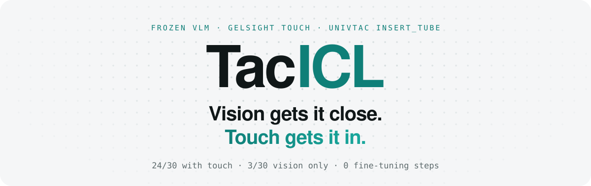
</p>

<p align="center">
  <a href="https://johnny-lauhm.github.io/TacICL/"></a>
  <a href="data/reports/univtac_icl_insert_tube_20261028/README_v2_scale30.md"></a>
  <a href="docs/tacicl_site/media/compare_1000003.mp4"></a>
</p>
<p align="center">
  
  
  
  
  
</p>

<p align="center">
  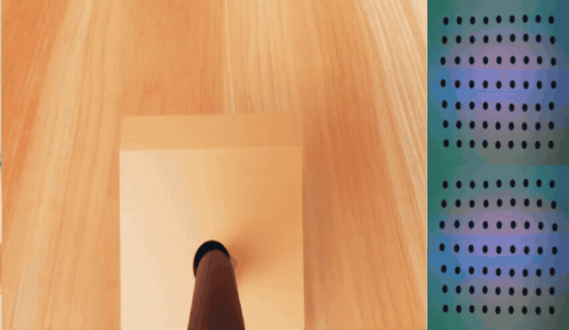
  <br>
  <sub><b>Wrist camera + both GelSight pads · evaluation seed 1000003 · 2×.</b> The tube stops at the rim of a 30° hole hidden 1–4 mm off-axis.<br>The marker dots on the right shear under the load. That shear is what moves the hand.</sub>
</p>

<br>

## Get the highlights.

<table>
<tr>
<td width="33%" valign="top">
<h1>8×</h1>
<b>More insertions than vision alone.</b><br>
<sub>24 / 30 with tactile ICL vs 3 / 30 with the same model, the same demonstration and the same cameras. Fisher p ≈ 5.6·10⁻⁸.</sub>
</td>
<td width="33%" valign="top">
<h1>0</h1>
<b>Gradient steps.</b><br>
<sub>The policy is a frozen 3-bit local Qwen with thinking off. Touch reaches it through the context: receipts, a jam history and one demonstration in the same format.</sub>
</td>
<td width="33%" valign="top">
<h1>~1 mm</h1>
<b>From pixels to millimetres.</b><br>
<sub>Pad shear asymmetry predicts the hand's offset from the hole axis with about 1 mm residual. The sign was right at 20 / 20 calibration jams.</sub>
</td>
</tr>
</table>

<br>

## Same seed. Three policies.

Evaluation seed 1000003. The hole is hidden 3.1 mm off in x and 1.9 mm in y. Same frozen model, same demonstration, same cameras. Only what touch is allowed to do changes.

<table>
<tr>
<th width="33%">Vision only</th>
<th width="33%">Touch stops the arm</th>
<th width="33%">Tactile ICL (ours)</th>
</tr>
<tr>
<td>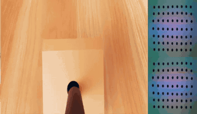</td>
<td>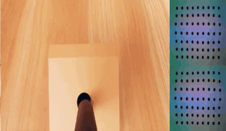</td>
<td>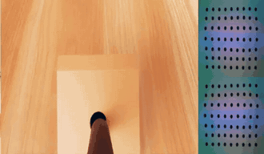</td>
</tr>
<tr>
<td valign="top"><b>❌ Keeps pushing.</b><br><sub>Vision cannot resolve a 2–3 mm offset at the rim. The tube jams and slides more than 3 cm inside the gripper. 26 of 30 vision-only episodes end this way.</sub></td>
<td valign="top"><b>❌ Stops in time. Then guesses.</b><br><sub>The guard halts each push. Raw shear numbers alone give the model no direction, so it re-pushes at the rim and the tube still slides out. 0 / 10 in the ablation.</sub></td>
<td valign="top"><b>✅ Reads the jam. Moves 1 mm.</b><br><sub>The receipt says <code>shift_hand_y_mm: +1.0</code>. The model backs off, shifts, pushes, then steps 0.3 mm between two jams. In after 6 calls.</sub></td>
</tr>
</table>

<sub>Wrist camera and both gel pads, 2×. Full three-row video with head camera: <a href="docs/tacicl_site/media/compare_1000003.mp4"><code>compare_1000003.mp4</code></a>.</sub>

<br>

## One loop. Two systems.

<p align="center">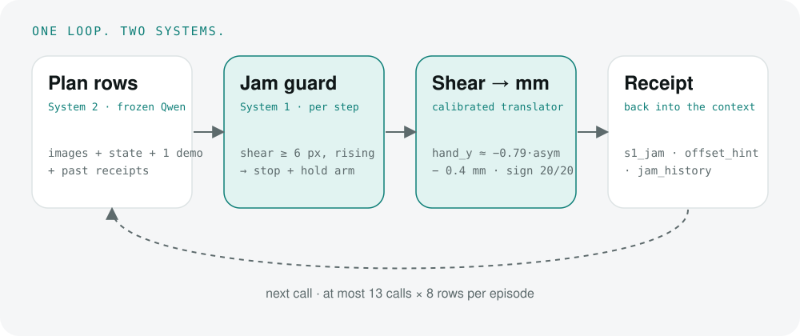</p>

| | What happens | Where |
|---|---|---|
| **Plan** | The frozen VLM reads head and wrist images, robot state, one demonstration and its own earlier receipts. It writes up to 8 rows `[dx,dy,dz,rx,ry,rz,finger]` plus a one-line `execution_note`. | `policy.py`, `dialogue.py` |
| **Guard** | System 1 executes the rows one control step at a time and reads only the gel marker field. When axial shear reaches ≥ 6 px and is still rising, it stops the row and holds the measured joint positions with zero velocity. | `jam_guard.execute` |
| **Translate** | Pad asymmetry `\|R\| − \|L\|` becomes `shift_hand_y_mm` via `hand_y ≈ −0.79·asym − 0.4 mm`, calibrated on separate development seeds. Lateral shear gives a low-confidence x direction. | `jam_guard.offset_estimate` |
| **Remember** | The receipt returns the stop, the shear, the estimate and every earlier jam position. When two jams point in opposite directions, the model moves between them. | `jam_history` |

### The demonstration speaks touch, too.

Official episode 37 is cut where the expert's first push stalled (frame 30). That block is replayed with the exact receipt System 1 would have produced from the demonstration's own marker shear. Its hint points the way the expert really corrected. Before the first live call, the model has already seen *jam → read touch → small shift → push* once.

```json
{
  "stop_reason": "s1_jam",
  "system1": {
    "events": [{"row": 4, "event": "jam"}],
    "marker_shear_px": {"axial_left_px": -7.24, "axial_right_px": 4.57, "lateral_px": -0.18, "asymmetry_px": -2.67},
    "offset_hint": {"shift_hand_y_mm": -2.0, "y_confidence": "high", "shift_hand_x": "+", "x_confidence": "low"},
    "jam_history": [{"call": 0, "ee_x_mm": 489.3, "ee_y_mm": -6.1, "shift_hand_y_mm": -2.0, "shift_hand_x": "+"}]
  }
}
```

<br>

## One jam. One number.

Seed 1000003, call by call. Each quote is the model's own `execution_note`, verbatim. The JSON is what System 1 returned for that call. Click a call to open it.

<details><summary><b>Call 1</b> · ⚪ rows completed</summary>

> LIVE start: tube held above the inclined block, hole slightly ahead/right of the tube tip. Mirroring the demonstration's coarse approach: move forward (+x) and down (-z) toward the inclined face while keeping the grip at 5.7 mm.

```json
{
 "stop_reason": "rows completed",
 "marker_shear_px": {
  "axial_left_px": -2.3,
  "axial_right_px": 0.74,
  "lateral_px": -1.02,
  "asymmetry_px": -1.56
 }
}
```
</details>
<details><summary><b>Call 2</b> · 🟠 s1_jam → shift_hand_y_mm +1.0</summary>

> No jam yet and the tube tip is close to the inclined face but not yet seated in the hole. Continue the demonstration-style advance: small forward/down steps along the tube axis toward the hole, keeping the grip fixed.

```json
{
 "stop_reason": "s1_jam",
 "marker_shear_px": {
  "axial_left_px": -4.53,
  "axial_right_px": 5.9,
  "lateral_px": -1.53,
  "asymmetry_px": 1.36
 },
 "offset_hint": {
  "shift_hand_y_mm": 1.0,
  "y_confidence": "high",
  "shift_hand_x": "+",
  "x_confidence": "low"
 },
 "jam_history": [
  {
   "call": 1,
   "ee_y_mm": -0.5,
   "shift_hand_y_mm": 1.0
  }
 ]
}
```
</details>
<details><summary><b>Call 3</b> · ⚪ rows completed</summary>

> Jam at the hole rim: System 1 says shift hand y by +1.0 mm (high confidence) and x slightly +. Back off ~1 mm along the tube/hole axis, apply the y (+1) and small x (+1) re-centring, then push back along the axis in short rows.

```json
{
 "stop_reason": "rows completed",
 "marker_shear_px": {
  "axial_left_px": -2.6,
  "axial_right_px": 0.59,
  "lateral_px": -0.94,
  "asymmetry_px": -2.01
 }
}
```
</details>
<details><summary><b>Call 4</b> · 🟠 s1_jam → shift_hand_y_mm +0.0</summary>

> No jam after the re-centring; shear is low and the tip sits at the inclined face. Continue pushing along the tube axis (forward +x, down -z) in short rows so the tube can enter the tight hole.

```json
{
 "stop_reason": "s1_jam",
 "marker_shear_px": {
  "axial_left_px": -5.53,
  "axial_right_px": 5.37,
  "lateral_px": -0.22,
  "asymmetry_px": -0.16
 },
 "offset_hint": {
  "shift_hand_y_mm": 0.0,
  "y_confidence": "high",
  "shift_hand_x": "+",
  "x_confidence": "low"
 },
 "jam_history": [
  {
   "call": 1,
   "ee_y_mm": -0.5,
   "shift_hand_y_mm": 1.0
  },
  {
   "call": 3,
   "ee_y_mm": 0.5,
   "shift_hand_y_mm": 0.0
  }
 ]
}
```
</details>
<details><summary><b>Call 5</b> · 🟠 s1_jam → shift_hand_y_mm +0.5</summary>

> Jam at the rim with y estimate now 0.0 (high confidence), so y is centred; only a low-confidence +x hint remains. Back off ~1 mm along the hole axis, nudge x by +1 mm, then push along the axis again in short rows.

```json
{
 "stop_reason": "s1_jam",
 "marker_shear_px": {
  "axial_left_px": -5.41,
  "axial_right_px": 5.77,
  "lateral_px": 0.42,
  "asymmetry_px": 0.36
 },
 "offset_hint": {
  "shift_hand_y_mm": 0.5,
  "y_confidence": "high",
  "shift_hand_x": "-",
  "x_confidence": "low"
 },
 "jam_history": [
  {
   "call": 1,
   "ee_y_mm": -0.5,
   "shift_hand_y_mm": 1.0
  },
  {
   "call": 3,
   "ee_y_mm": 0.5,
   "shift_hand_y_mm": 0.0
  },
  {
   "call": 4,
   "ee_y_mm": 0.4,
   "shift_hand_y_mm": 0.5
  }
 ]
}
```
</details>
<details><summary><b>Call 6</b> · 🟢 task_success</summary>

> Jam again at the rim; y estimates bracket the hole (0.0 then +0.5) so I take a small +0.3 mm y correction rather than the full amount, back off ~1 mm along the hole axis first, and x hint flipped sign so I leave x alone. Then push along the axis again in short rows.

```json
{
 "stop_reason": "task_success",
 "marker_shear_px": {
  "axial_left_px": -2.57,
  "axial_right_px": 2.09,
  "lateral_px": 0.01,
  "asymmetry_px": -0.48
 }
}
```
</details>

<br>

## Calibrated, not guessed.

<table>
<tr>
<td width="55%">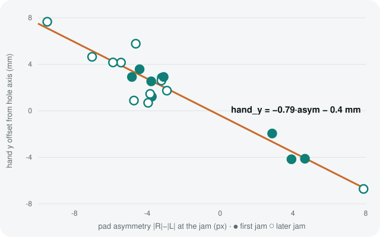</td>
<td width="45%" valign="top">

On 14 development seeds a probe pushed the tube into the rim, recorded the shear, made a deliberately imperfect correction and pushed again. The privileged hand-to-axis offset served **only as a label**; evaluation never reads it.

| | |
|---|---|
| sign correct | **20 / 20** jams |
| fit | `hand_y = −0.79·asym − 0.4 mm` |
| residual | 0.7 mm first jams · 1.1 mm all |
| x from lateral shear | ≈ 50 % → low confidence |

</td>
</tr>
</table>

<br>

## 30 seeds. Every dot.

<p align="center">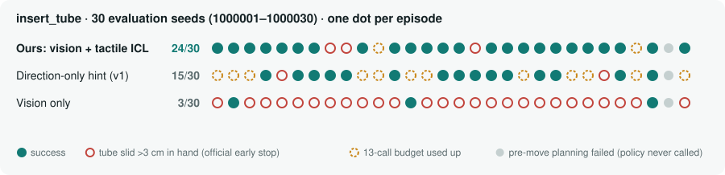</p>

| Method · same frozen model, same single demonstration | Success | Slid out | Out of calls | Calls / ep. |
|---|:---:|:---:|:---:|:---:|
| **Tactile ICL (ours, guard v2)**: mm estimate + jam history + tactile demo | **24 / 30** | 3 | 2 | **6.3** |
| Direction-only hint (guard v1) | 15 / 30 | 2 | 12 | 9.4 |
| Vision only (direct control) | 3 / 30 | 26 | 0 | 2.8 |

- **Significance:** Fisher exact, two-sided. Ours vs vision only p ≈ 5.6·10⁻⁸; ours vs direction-only p = 0.029.
- **Both sides of the hidden offset:** 7 / 9 with y > 0 and 17 / 21 with y < 0. The earlier vision-only successes came only from copying the demonstration's sidestep.
- **pre-move failures:** each method has one seed where official pre-move planning failed before the policy ran. It counts as a failure; without it the scores are 24/29, 15/29 and 3/29.

<details>
<summary><b>How we got here: the ablation path</b></summary>

| Step | Change | Result |
|---|---|---|
| v5 | direct control; vision vs vision + tactile images and press depth | visual 3/10 (all on y > 0 seeds) · visuotactile 0/10 |
| guard v1, no hint | per-step jam guard, raw shear in the receipt | **0/10** |
| guard v1 | + direction hint | 5/10, then 15/30 |
| **guard v2** | + mm estimate, jam history, tactile TRAIN receipt | **24/30** |

The direction-only guard failed mostly by overshooting. It moved about 4 mm per correction when the median residual was 2.8 mm, and 12 of its 30 episodes ran out of calls.
</details>

<br>

## More rollouts.

<table>
<tr>
<td width="50%">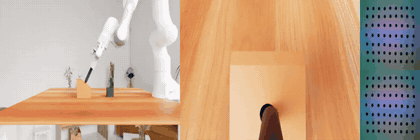<br><sub>✅ <b>1000014</b> · offset x −3.3, y −3.8 mm · 4 jams</sub></td>
<td width="50%"><br><sub>❌ <b>same seed, vision only</b> · pushes on, tube slides out</sub></td>
</tr>
<tr>
<td>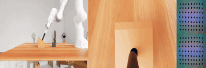<br><sub>✅ <b>1000019</b> · offset x −2.5, y +3.8 mm · 2 jams</sub></td>
<td><br><sub>✅ <b>1000021</b> · offset x +3.5, y −3.1 mm · 4 jams</sub></td>
</tr>
</table>

<br>

## Where it still breaks.

<table>
<tr>
<td width="50%">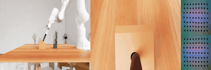</td>
<td width="50%">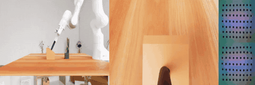</td>
</tr>
<tr>
<td valign="top"><b>Aligned, but stuck deep</b> · 3 / 30<br><sub>Seeds 1000009, 1000011, 1000027. The y estimate converges to within 1 mm, yet the tube keeps stalling around 25 mm deep while in-hand slip accumulates. The current signals cannot tell sliding in from slipping in the hand.</sub></td>
<td valign="top"><b>The first push goes the wrong way</b> · 2 / 30<br><sub>Seeds 1000008, 1000017. The first call pushes along −x, off the hole axis. The guard fires late or not at all. This is a coarse-vision error: touch never gets its turn.</sub></td>
</tr>
</table>

<br>

## Questions? Answers.

<details>
<summary><b>Is the model fine-tuned?</b></summary><br>
No. It is a frozen local Qwen (<code>qwen3.8-flash-next-iq3_s</code>) with thinking off. Everything it knows about touch comes from its context: receipts, the jam history and the single demonstration rendered in the same receipt format.
</details>
<details>
<summary><b>Does the policy ever see where the hole is?</b></summary><br>
No. During evaluation the policy reads only cameras, robot state, finger press depth and the gel marker field. The hole pose was used only offline, as a label on separate development seeds, to fit the shear-to-millimetre line.
</details>
<details>
<summary><b>So did the VLM learn to read touch?</b></summary><br>
Not on its own. With the jam guard and raw shear numbers but no translated hint, it scored 0/10. The gain comes from the calibrated translator plus the tactile demonstration. The VLM follows the contact routine and brackets the hole between jams, and it does that reliably.
</details>
<details>
<summary><b>Why can't vision do the last few millimetres?</b></summary><br>
The hidden offset is 1–4 mm, one or two pixels in a 480×270 frame. At the rim, the tube and fingers hide the hole edge. Vision-only rollouts keep pushing; the tube jams and slides out of the gripper in 26 of 30 episodes.
</details>
<details>
<summary><b>Why is x only a low-confidence direction?</b></summary><br>
In the policy runs, lateral shear matched the hidden x offset at every first jam. In the calibration probe, with pure axial pushes, it was right only about half the time. Until that gap is explained, x is labelled low confidence and the prompt only allows 1 mm x probes after y has converged.
</details>
<details>
<summary><b>What would a real robot need?</b></summary><br>
Its own calibration of the translator: known-offset push trials that use the arm's repeatability as the label, or labels recovered after the fact from successful insertions. It also needs slow, compliant pushing, with every command going through the runtime's safety gate. The structure carries over; the numbers do not.
</details>

<br>

## Run it.

```bash
# 1. TRAIN reference v3: official episode 37, expert jam at frame 30
python -m prometheus.workflows.univtac_icl --config-name univtac_icl_insert_tube \
  operation=build_reference run_id=build_ref condition=visuotactile

# 2. tactile ICL (guard v2)
python -m prometheus.workflows.univtac_icl --config-name univtac_icl_insert_tube \
  operation=prepare run_id=<run> condition=visuotactile \
  policy.control=guard policy.jam_hint=estimate reference_version=v3
python -m prometheus.workflows.univtac_icl operation=run run_id=<run> condition=visuotactile

# baselines
#   direction-only (guard v1): policy.control=guard policy.jam_hint=direction reference_version=v2
#   vision only:               condition=visual policy.control=direct reference_version=v2

# 3. tests
pytest tests/test_univtac_icl.py
```

<sub>This repository contains the TacICL policy, workflow, configs, tests and reports. The commands run inside the host robot runtime (the workflow runner and UniVTAC evaluation glue), which is not part of this release. They also need the UniVTAC Isaac Sim 5.1 environment (<code>data/envs/univtac-isaac51</code>) and the official HDF5 episodes under <code>data/datasets/univtac_official/</code>. Neither ships with this repository. The model is served locally by <code>scripts/run_qwen_univtac_local.sh</code>.</sub>

## Repository map

| Path | Contents |
|---|---|
| [`prometheus/policy/univtac_icl/`](prometheus/policy/univtac_icl) | `policy.py` episode loop · `jam_guard.py` guard and translator · `system1.py` controllers · `dialogue.py` prompts and receipts · `reference.py` TRAIN builder |
| [`prometheus/workflows/univtac_icl.py`](prometheus/workflows/univtac_icl.py) | build_reference / prepare / run |
| [`prometheus/configs/univtac_icl_insert_tube.yaml`](prometheus/configs/univtac_icl_insert_tube.yaml) | task, seeds, demonstration, jam frame |
| [`scripts/run_qwen_univtac_local.sh`](scripts/run_qwen_univtac_local.sh) | local model server launcher |
| [`data/reports/univtac_icl_insert_tube_20261028/`](data/reports/univtac_icl_insert_tube_20261028) | reports, per-seed summaries, calibration probes (`jam_probe.py`, `probe_multi.py`), analysis scripts |
| [`docs/tacicl_site/`](docs/tacicl_site) | project page, videos and figures |

<details>
<summary><b>中文摘要</b></summary><br>

**一句话：** 冻结的 VLM 负责看（把管子送到孔口），触觉负责最后几毫米。在 UniVTAC `insert_tube` 的 30 个评测 seed 上，成功率从纯视觉的 3/30 提高到 24/30，全程没有微调。

- **问题**：孔有 30° 倾角，间隙只有 0.5 mm，pre_move 留下 1–4 mm 的隐藏偏移。视觉看不清这么小的偏差，管子顶到孔口时还会遮住孔边。模型继续推，管子就在手里滑出 3 cm，被官方提前结束。
- **做法**：
  - System 1 jam guard 在每个控制步读取凝胶标记点的剪切。卡住时立即停下手臂，并保持当前位置。
  - 标定过的触觉翻译层把剪切换算成 `shift_hand_y_mm`。这个关系是在开发 seed 上用仿真真值标定出来的，评测时不读任何真值。
  - 示范里专家卡住的那一步，也按回执格式写进 TRAIN，让模型在上下文里看到"卡住 → 读触觉 → 小幅侧移 → 再推"的完整流程。
- **结论口径**：冻结的 Qwen 自己读不懂原始剪切数字（只给剪切、不给提示时 0/10）。起作用的是"标定过的翻译层 + 带触觉回执的示范"，模型负责执行，并会自己做夹逼。上真机需要重新标定翻译层。
</details>

## Citation

```bibtex
@misc{tacicl2026,
  title        = {TacICL: In-Context Tactile Insertion with a Frozen Vision-Language Model},
  author       = {{TacICL contributors}},
  year         = {2026},
  howpublished = {\url{https://github.com/Johnny-lauHM/TacICL}}
}
```

## Acknowledgements

TacICL uses the **UniVTAC** visuo-tactile benchmark on Isaac Sim 5.1 and its official expert demonstrations, and a locally served **Qwen** model. The ICL episode format follows **RoboICL**.
